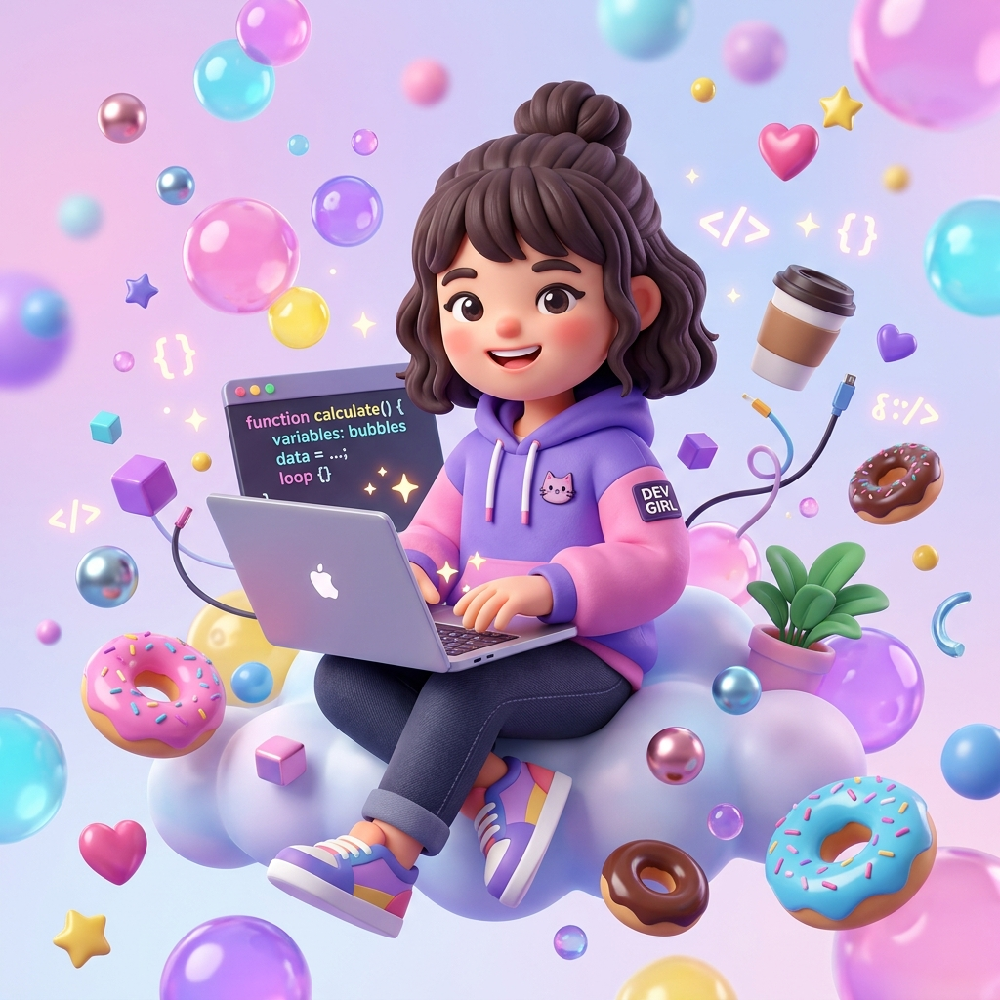

# 🫧 Mausam Kumari - 3D Cartoon Bubble Portfolio

A vibrant, eye-catching 3D portfolio website created for **Mausam Kumari** (B.Tech Computer Science student) featuring cartoonistic bubble aesthetics, solid pattern backgrounds, Three.js 3D physics, and playable arcade mini-games.



---

## 🎨 Color Palette & Aesthetic

Designed using the exact requested color harmony:
- **Hot Bubblegum Pink**: `#FF2D95`
- **Electric Cartoon Violet**: `#6F3DFF`
- **Cerulean Ocean Blue**: `#007BA7`
- **Soft Sky Bubble Blue**: `#BFE9FF`
- **Warm Marigold Yellow**: `#EAAA00`
- **Deep Midnight Plum**: `#3A0F34`
- **Warm Clay**: `#6F4E37`
- **Lavender Mist**: `#E6E0F0`
- **Pastel Cloud Blue-Gray**: `#DDE3E8`
- **Cream Canvas**: `#F3E6D7`
- **Platinum Pearl**: `#E5E4E2`
- **Obsidian Cartoon Ink**: `#0A0A0A`
- **Metallic Neutral**: `#B7B7B7`

---

## ✨ Standout Features

1. **Interactive 3D Bubble Canvas (Three.js)**:
   - Buoyant, squishy floating bubbles, 3D candy donuts (torus), capsules, and stars.
   - Interactive mouse cursor repulsion with spring physics.
   - Click anywhere to trigger shockwaves and popping mini-bubble particle bursts.

2. **Playable Mini-Games & Live Project Demos**:
   - **🌱 Carbon Footprint Tracker**: Interactive real-time calculator with commute, electricity, and diet sliders + tree offset metrics.
   - **🐍 Classic Snake Bubble Game**: Playable in-browser retro arcade game with bubble snake body, golden apples, high scores, and touch D-Pad controls.
   - **🐦 Flappy Bubble Bird**: Playable flapping bird arcade game with gravity physics and candy pipe obstacles.

3. **Cute Cartoon Sound Synthesizer (Web Audio API)**:
   - Zero external audio files required! Generates high quality cartoon pops, boings, and victory sparkles using native browser audio synthesis.
   - Polite toggle button (🔊 / 🔇) in the navigation bar.

4. **Pop Party Easter Egg**:
   - Click **"🫧 Pop Party"** to spawn floating bubbles rising up the screen. Click on any bubble to pop it with confetti and increase your score!

5. **Complete Resume Integration**:
   - Education: B.Tech Computer Science (2023 - 2027) @ Dr. C. V. Raman University, Bihar (CGPA: 7.5).
   - Filterable Superpowers (Python, JavaScript, HTML5/CSS3, React.js, Node.js, Express.js, Power BI, Git/GitHub).
   - 1-Click Copy for Email (`mausamsingh488@gmail.com`) and Phone (`+917079860581`) with cartoon toast alert.
   - Quick Printable Resume Summary modal.

---

## 🚀 How to Run Locally

1. Open your terminal in this directory:
   ```bash
   cd "C:\Users\Mausam\.gemini\antigravity-ide\scratch\mausam-portfolio"
   ```

2. Start a local server:
   ```bash
   python -m http.server 8181
   ```
   *Or with Node.js:*
   ```bash
   npx serve .
   ```

3. Open your browser and navigate to:
   ```
   http://localhost:8181
   ```

---

## 🌐 Deploy to Netlify / Vercel

Since this is built with standard HTML5, CSS3, and JavaScript, it can be deployed in seconds with zero build steps:
- **Netlify**: Drag and drop the `mausam-portfolio` folder directly into Netlify Drop (or push to GitHub and link).
- **Vercel**: Run `npx vercel` inside the folder.
- **GitHub Pages**: Push to a repository and enable GitHub Pages in Settings.
